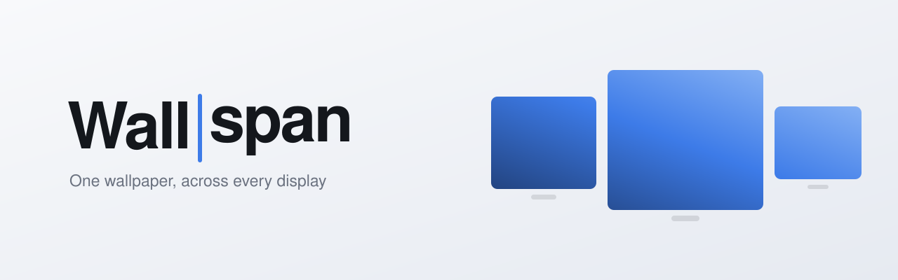

<p align="center">
  <picture>
    <source media="(prefers-color-scheme: dark)" srcset="brand/wallspan-banner-dark.svg">
    
  </picture>
</p>

# wallspan

A replacement for aging paid alternatives for applying multi monitor spanning wallpapers.

A menu bar app, and the command line tool underneath it. macOS 14 or later. No
dependencies, no telemetry, no subscription. The CLI never touches the network. The app
only does so to [check for updates](#checking-for-updates) when you ask, or automatically
if you turn that on.

## What it does

- **Spans one wallpaper across all your displays** as a single continuous image.
- **Compensates for bezels**, so the picture lines up to your eye.
- **Corrects for differing pixel density**, so an image is the same real-world size on
  each screen.
- **Helps you align your monitors**, so the cursor crosses each seam where the picture
  does.
- **Cycles a folder** on an interval, in the background and across logins.

## Install

**Stable:**

```sh
brew install --cask serubin/tap/wallspan

# or
brew tap serubin/tap
brew install --cask wallspan
```

**Beta:**

```sh
brew install --cask serubin/tap/wallspan@beta

# or
brew tap serubin/tap
brew install wallspan@beta
```

Upgrading or switching casks turns cycling off, so choose **Enable Cycling** again after.

Without Homebrew, grab `Wallspan-<version>.zip` from the latest prerelease on the
[releases page](../../releases).

## Getting started

Wallspan lives in the menu bar.

1. **Choose Folder…** - pick a folder of images. Avoid Desktop, Documents and Downloads:
   the background agent can't ask for permission there, so it fails quietly.
2. **Change Every** - 5 minutes to a day.
3. **Enable Cycling**.

**Next Wallpaper** changes it now. **Pause Cycling** stops the schedule, and stays paused
across reboots.

**Enable Cycling** installs a LaunchAgent that keeps running after you quit the app and
across logins. **Open Wallspan at Login** is separate and only brings the menu bar item
back.

## Calibrating your displays

macOS places displays edge to edge, with no way to describe the bezels between them, so a
spanned image breaks across each seam. wallspan models each panel in millimetres, so the
part of the image behind a bezel is hidden, not squeezed into view.

**Displays ▸ Calibrate…** draws a test pattern over every screen without touching your
wallpaper. Line up the long diagonals across each bezel:

- **Position** - arrow keys, or drag a screen. Diagonals stepping **down-right** across a
  seam mean the gap is too small, **up-right** too large. Your main display stays put.
- **Scale** - **Panel scale**, or **⌥↑ / ⌥↓**. Use it when circles break across a seam but
  the diagonals line up.

**Align in System Settings…** then lines up the macOS display arrangement vertically to
match, which decides where the cursor crosses between screens. It shows the change first.
**Revert to Saved** or `wallspan layout arrange --revert` restores the arrangement you had
before wallspan.

### Panel sizes

macOS reads each panel's size from EDID, and monitors often get it wrong. One LG here
claims 109 PPI across but 111 PPI down, which no real panel has. wallspan keeps the
reported diagonal, which EDID rounding barely moves, and forces square pixels. That
removes the non-square error without asking.

A size wrong by the same proportion on both axes looks consistent, so only your eye can
catch it - that's what Panel scale is for. A ⚠︎ in the **Displays** submenu means a stored
size still implies non-square pixels. Set both axes with `wallspan layout size`.

## The command line

The app changes your wallpaper and layout by running `wallspan`, and the CLI covers what
the app doesn't.

```sh
wallspan info                                  # your displays, and how they're mapped
wallspan preview img.jpg -o out.png            # see the crop without touching anything
wallspan apply img.jpg                         # span it across every display
wallspan cycle ~/Pictures/Backgrounds --interval 15m
wallspan restore                               # back to your wallpaper from before wallspan

wallspan status                                # what is on screen, and what is next
wallspan next
wallspan pause
wallspan resume
```

### Running unattended

```sh
wallspan config set --dir ~/Pictures/Backgrounds --interval 15m
wallspan agent install
wallspan agent uninstall
```

Enable Cycling runs `agent install --binary` with the `wallspan` the app is using, while
plain `agent install` copies the CLI into `~/.local/bin`.

Settings live in `~/Library/Application Support/wallspan/config.json`, and a running agent
picks up changes within seconds:

```json
{
  "idleDeferSeconds" : 5,
  "intervalSeconds" : 900,
  "playlistDirectory" : "/Users/you/Pictures/Backgrounds",
  "recursive" : false,
  "shuffle" : true
}
```

`idleDeferSeconds` holds a scheduled change until there's been no keyboard or mouse input
for that many seconds, waiting at most half an interval or five minutes, whichever is
shorter. `--idle-defer off` turns it off. Logs go to
`~/Library/Logs/wallspan.log`.

### Calibrating from the command line

```sh
wallspan calibrate                                  # set the test pattern as wallpaper
wallspan layout nudge dell --dx 20px --dy -4px
wallspan layout size lg --ppi 109.6                 # or --width 797.22mm from the spec
wallspan layout show
wallspan layout reset                               # back to edge to edge
wallspan layout arrange [--dry-run | --revert]
wallspan verify-mapping <image|directory>           # check the rendered output
wallspan restore                                    # when you are done
```

Pause cycling first, or the next change replaces the pattern.

## How the app finds the CLI

The app has no wallpaper logic of its own. It runs whichever `wallspan` is on your `PATH`,
and falls back to the copy in its bundle if that one is missing or speaks a contract
version the app doesn't understand. The [JSON contract](docs/cli-json-contract.md)
between them is versioned.

**About Wallspan…** shows which copy is in use and why.
`defaults write net.serubin.wallspan.app PreferBundledCLI -bool true` pins it to the
bundled one. **Install CLI…** symlinks the bundled CLI into `~/.local/bin` when no other
`wallspan` is installed.

## Checking for updates

Off until you turn on **Check for Updates Automatically**, or choose **Check for
Updates…**. A check is one unauthenticated request, and automatic ones run at most once a
day:

```
https://api.github.com/repos/Serubin/WallSpan/releases/latest
```

Beta installs ask for `releases?per_page=10` instead, since `latest` skips prereleases.
That does tell GitHub the install follows betas. Only `tag_name`, `draft` and
`prerelease` are read. The request carries no identifier, no cookies, and a bare
`User-Agent: Wallspan` and `Accept-Language: en`, so it doesn't leak your app version,
macOS build or languages.

Nothing downloads or updates itself. You get a menu entry pointing at the release page,
or at `brew upgrade` if Homebrew installed it. A failed automatic check stays silent.

## Known limits

- **Per-Space wallpaper.** macOS keeps a wallpaper per Space. Cycling applies the image to
  each Space as you arrive, but a one-shot `wallspan apply` only reaches the current one.
  Setting a wallpaper costs macOS about 2.4s of CPU whatever the image, so cycling skips
  Spaces that already have it.
- **One `cycle` at a time.** A second one exits and names the pid holding the lock.
- **The render cache never evicts.** It lives in
  `~/Library/Application Support/wallspan/rendered` and is safe to delete.
- **Some of the image is discarded.** Anything behind a bezel, or above and below a shorter
  screen, isn't shown - roughly a third of the source with an ultrawide beside a portrait
  panel. `wallspan layout show` prints the figure.
- An image that already matches one display exactly still gets scaled and cropped, since
  it's mapped across the whole arrangement.

## Build

```sh
swift build -c release
Scripts/make-app.sh            # builds dist/Wallspan.app
swift test
```

Needs only the Command Line Tools Swift toolchain and no signing certificate. `swift test`
needs Xcode.

## Releases

`wallspan version` prints which channel a build came from:

| channel | example | from | signed |
|---|---|---|---|
| `release` | `0.2.0` | the [releases page](../../releases) | Developer ID, notarised |
| `beta` | `0.2.0-beta.3`, `0.2.0-rc.1` | a prerelease, and `wallspan@beta` | Developer ID, notarised |
| `unsigned` | `0.2.0-unsigned.1` | a test of the release workflow | ad-hoc |
| `snapshot` | `0.2.1-snapshot.7+g1a2b3c4` | each merge to `main`, as a CI artifact | ad-hoc |
| `dev` | `0.2.1-dev.pr42+g1a2b3c4` | a pull request, as a CI artifact | ad-hoc |

Each release ships the app, the CLI as a tarball and a bare binary, and `SHA256SUMS.txt`.
The first run of a downloaded CLI needs a network connection, so macOS can check its
notarisation. Ad-hoc builds are blocked by Gatekeeper once downloaded.

Cutting a release is covered in [docs/releasing.md](docs/releasing.md).

## License

GPL-3.0-or-later. See [LICENSE](LICENSE).

GPL so it can't become a closed paid product like the tools it replaces: anyone who
distributes it must share the full source under the same terms. It's written
from scratch against public AppKit APIs, with no code taken from any existing product.

## Acknowledgement

Made and maintained by a 15-year software veteran with the help of AI.
